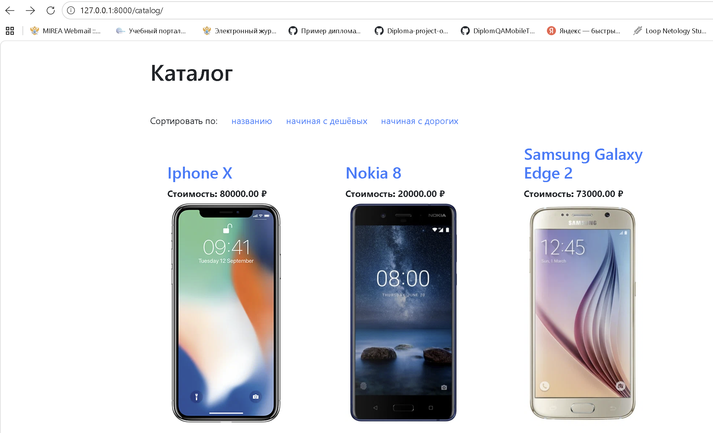
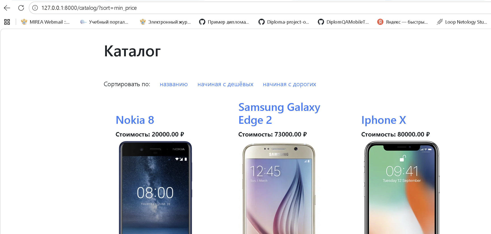
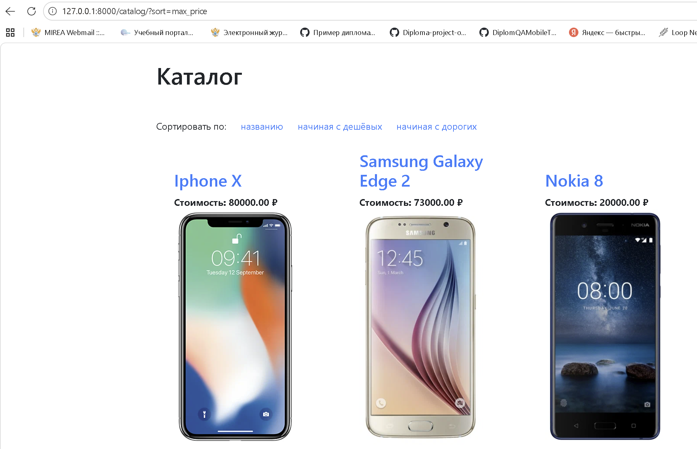

# Каталог телефонов (Phone Catalog)

Проект на Django, представляющий собой региональный сайт-каталог телефонов партнера. Данные загружаются из CSV-файла, сохраняются в базу данных PostgreSQL и отображаются на сайте с возможностью сортировки.

## Стек технологий
* Python 3.13
* Django 6.1
* PostgreSQL
* Psycopg 3 (драйвер БД)

## Инструкция по запуску

Для запуска проекта локально выполните следующие шаги:

### 1. Клонирование репозитория и настройка окружения
```bash
git clone <ссылка_на_ваш_репозиторий>
cd work_with_database
```
Создайте и активируйте виртуальное окружение:
Для Windows:
```bash
python -m venv venv
venv\Scripts\activate
```
Для macOS/Linux:

```bash
python3 -m venv venv
source venv/bin/activate
```
### 2. Установка зависимостей
```bash
pip install -r requirements.txt
```
### 3. Настройка базы данных
1. Убедитесь, что у вас установлен и запущен PostgreSQL.
2. Создайте базу данных (например, netology_import_phones).
3. Откройте файл main/settings.py и укажите ваши данные для подключения в блоке DATABASES:

```python
DATABASES = {
    'default': {
        'ENGINE': 'django.db.backends.postgresql',
        'NAME': 'netology_import_phones',
        'HOST': '127.0.0.1',
        'PORT': '5432',
        'USER': 'postgres',
        'PASSWORD': 'ваш_пароль',
    }
}
```
### 4. Миграции
Примените миграции для создания необходимых таблиц в базе данных:

```bash
python manage.py makemigrations
python manage.py migrate
```
### 5. Загрузка данных из CSV
В корне проекта находится файл phones.csv. Чтобы загрузить данные в базу, выполните команду:

```bash
python manage.py import_phones
```
Если команда выполнится успешно, вы увидите сообщение "Данные успешно импортированы!".

### 6. Запуск сервера
```bash
python manage.py runserver
```
После запуска сервер будет доступен по адресу: http://127.0.0.1:8000/

## Маршруты (URLs)
1. /catalog/ - главная страница каталога со всеми телефонами.
2. /catalog/?sort=name - сортировка по названию (А-Я).
3. /catalog/?sort=min_price - сортировка по цене (от дешевых к дорогим).
4. /catalog/?sort=max_price - сортировка по цене (от дорогих к дешевым).
5. /catalog/<<slug>>/ - страница конкретного телефона (например, /catalog/nokia-8/).
6. /admin/ - панель администратора Django (требуется создание суперпользователя).

## Скриншоты




